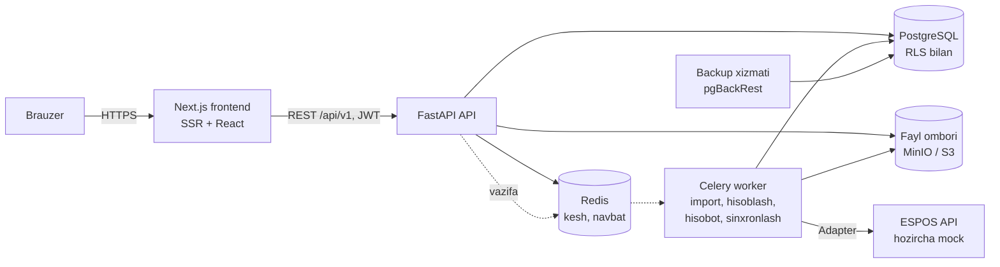
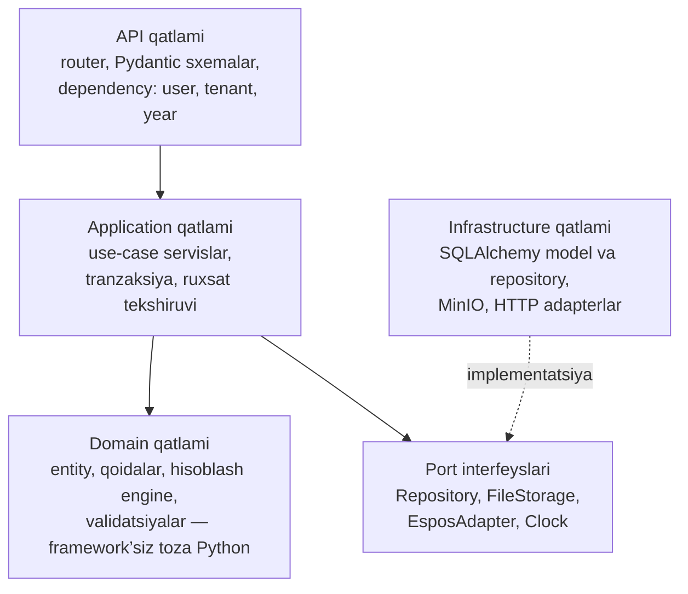

# 1. Umumiy arxitektura

## 1.1. Arxitektura uslubi

UniLoad — **modulli monolit** (modular monolith) sifatida quriladi:

- Bitta FastAPI backend, lekin ichida qat’iy ajratilgan biznes-modullar (`academic_years`, `curricula`, `calculation`, `distribution` …).
- Har bir modul Clean Architecture qatlamlariga bo‘linadi; modullar bir-biriga faqat **application service interfeysi** orqali murojaat qiladi (boshqa modul jadvaliga to‘g‘ridan-to‘g‘ri yozmaydi).
- Kelajakda og‘ir modullarni (PDF tahlil, hisobotlar, ESPOS sinxronlash) alohida servisga ajratish oson bo‘ladi, ammo MVP bosqichida mikroservislar murakkabligi kerak emas.



| Komponent | Vazifasi |
|---|---|
| **Next.js frontend** | UI, SSR, autentifikatsiya cookie’lari, i18n (uz/ru/en). Backend bilan faqat REST orqali ishlaydi. |
| **FastAPI API** | Biznes-logika, RBAC, tenant isolation, OpenAPI (`/docs`). |
| **Celery worker** | Uzoq davom etadigan ishlar: Excel/PDF import, o‘quv yilini nusxalash, yuklama hisoblash, hisobot generatsiyasi, ESPOS outbox. |
| **PostgreSQL 16** | Asosiy ma’lumotlar. Row-Level Security (RLS) — tenant izolyatsiyasining ikkinchi qatlami. |
| **Redis 7** | Celery broker, kesh (ma’lumotnomalar, dashboard statistikasi), rate-limit. |
| **MinIO / S3** | Yuklangan fayllar (Excel, PDF), generatsiya qilingan hisobotlar. |
| **pgBackRest** | Kunlik to‘liq backup + WAL arxiv (istalgan daqiqaga tiklash). |

## 1.2. Backend qatlamlari (Clean Architecture)



Qoida: **domain** qatlami FastAPI, SQLAlchemy yoki Redis’ni bilmaydi. Hisoblash engine’i (`domain/rules_engine`) toza funksiyalar to‘plami — shuning uchun uni PDF’dagi natijalar bilan unit-testlar orqali tekshirish oson.

## 1.3. Repozitoriya tuzilmasi

```
uniload/
├── docker-compose.yml          # postgres, redis, minio, api, worker, frontend, espos-mock
├── docs/                       # ushbu hujjatlar
├── backend/
│   ├── pyproject.toml
│   ├── alembic/                # migratsiyalar
│   ├── app/
│   │   ├── main.py
│   │   ├── core/               # config, security, tenancy, permissions, errors, logging
│   │   ├── db/                 # session, base model, RLS yordamchilari
│   │   ├── shared/             # umumiy domain tiplari (Hours, YearLabel, ...)
│   │   └── modules/
│   │       ├── auth/
│   │       ├── tenants/        # universities, subscriptions
│   │       ├── users/          # users, roles, permissions
│   │       ├── academic_years/
│   │       ├── org/            # faculties, departments
│   │       ├── programs/
│   │       ├── curricula/      # o‘quv rejalar, fanlar
│   │       ├── groups/         # guruhlar, oqimlar
│   │       ├── teachers/
│   │       ├── rules/          # Calculation Rules Engine
│   │       ├── calculation/
│   │       ├── distribution/
│   │       ├── approvals/
│   │       ├── imports/        # Excel, PDF
│   │       ├── reports/
│   │       ├── integrations/espos/
│   │       └── audit/
│   │           # har bir modul ichida:
│   │           #   api.py  schemas.py  service.py  domain.py
│   │           #   models.py  repository.py  tasks.py  tests/
│   ├── workers/                # Celery app
│   └── tests/                  # integration, tenant-isolation, golden testlar
├── frontend/
│   ├── src/app/                # Next.js App Router sahifalari
│   ├── src/components/ui/      # shadcn/ui
│   ├── src/components/common/  # DataTable, ConfirmDialog, StatCard, ...
│   ├── src/features/<modul>/   # API hook’lar, formalar, Zod sxemalar
│   ├── src/lib/api/            # OpenAPI’dan generatsiya qilingan tiplar
│   └── src/i18n/               # uz.json, ru.json, en.json
└── espos-mock/                 # ESPOS uchun soxta API (FastAPI)
```

## 1.4. Asosiy texnik qarorlar

| Mavzu | Qaror | Sabab |
|---|---|---|
| ID’lar | UUID (v7) | Tenantlar o‘rtasida ID taxmin qilib bo‘lmaydi; tartiblanadi. |
| Soatlar | `NUMERIC(10,2)` | `float` yaxlitlash xatolari yuklamada qabul qilinmaydi. |
| Autentifikatsiya | Access JWT (15 daqiqa) + refresh token `httpOnly`, `Secure`, `SameSite=Strict` cookie’da, rotatsiya bilan; parollar Argon2id | XSS’da tokenni o‘g‘irlab bo‘lmaydi; sessiyani bekor qilish mumkin. |
| Server holati (frontend) | TanStack Query | Kesh, qayta so‘rov, optimistik yangilash. *(Ro‘yxatga qo‘shimcha taklif.)* |
| Drag-and-drop | dnd-kit | Taqsimot oynasi uchun, klaviatura bilan ham ishlaydi. |
| i18n | Yengil tiplangan lug‘at (`frontend/src/i18n/uz.ts`, `useT()`), backend xatolari `code` bilan qaytadi | Rus/ingliz tilini qo‘shish — faqat `ru.ts`/`en.ts` fayli. next-intl o‘rniga: barcha sahifalar client-side, alohida routing kerak emas. |
| Fon vazifalari | Celery + Redis | PDF/OCR kabi og‘ir ishlar uchun yetuk yechim. |
| API tiplari | `openapi-typescript` bilan avtomatik generatsiya | Frontend va backend kontrakti doim mos. |
| Bir vaqtda tahrirlash | `row_version` (optimistik qulf), so‘rov tanasida | Ikki kafedra xodimi bir-birining taqsimotini bilmasdan o‘chirib yubormaydi. |

## 1.5. Multi-tenant izolyatsiya (3 qatlam)

1. **Kontekst qatlami.** JWT ichida `user_id`, `university_id`, rollar. Har bir so‘rovda middleware `TenantContext` (contextvar) o‘rnatadi. `university_id` hech qachon so‘rov tanasidan olinmaydi.
2. **Repository qatlami.** Barcha repository’lar `TenantScopedRepository` bazaviy klassidan meros oladi va har bir so‘rovga avtomatik `WHERE university_id = :ctx` qo‘shadi. Uni chetlab o‘tish faqat Super Admin uchun alohida `PlatformRepository` orqali.
3. **Ma’lumotlar bazasi qatlami.** PostgreSQL RLS:
   ```sql
   ALTER TABLE student_groups ENABLE ROW LEVEL SECURITY;
   CREATE POLICY tenant_isolation ON student_groups
     USING (university_id = current_setting('app.university_id')::uuid);
   ```
   Ilova `uniload_app` roli bilan ulanadi (jadval egasi emas, `BYPASSRLS` yo‘q). Har bir tranzaksiya boshida `SET LOCAL app.university_id = ...`.

Qo‘shimcha: barcha yil va tenantga bog‘liq jadvallarda **kompozit tashqi kalit** `(university_id, academic_year_id) → academic_years(university_id, id)`. Bu bir universitet guruhini boshqa universitet o‘quv yiliga bog‘lab qo‘yishni DB darajasida imkonsiz qiladi.

Sinov: avtomatik test barcha endpointlarni aylanib chiqadi va A universitet tokeni bilan B universitet resurslariga murojaat `404` qaytarishini tekshiradi (5-bosqichda kengaytiriladi, lekin 1-bosqichdan boshlab yoziladi).

## 1.6. O‘quv yillari izolyatsiyasi va o‘zgarmaslik

- Yilga bog‘liq barcha ma’lumotlar (`student_groups`, `teacher_employment`, `streams`, `workload_*`, `semesters`, `position_norms`) `academic_year_id` bilan saqlanadi. Yangi yil yaratilganda **yangi qatorlar** yaratiladi — qatorlar yillar o‘rtasida hech qachon bo‘lishilmaydi.
- O‘quv rejalari ko‘p yillik hujjat bo‘lgani uchun **versiyalanadi**: tasdiqlangan versiya o‘zgarmaydi, o‘zgarish — yangi versiya. `workload_items` hisoblash paytidagi soatlarning **snapshot**’ini saqlaydi, shuning uchun reja keyin o‘zgarsa ham o‘tgan yil natijasi o‘zgarmaydi.
- `Tasdiqlangan` va `Arxivlangan` yildagi yozuvlarni o‘zgartirishni DB trigger bloklaydi. Istisno — maxsus `workload.override` ruxsati: foydalanuvchi sabab yozadi, tranzaksiyada `app.override_reason` o‘rnatiladi, trigger o‘tkazib yuboradi va audit logga “oldin/keyin” yoziladi.

## 1.7. Audit log va backup

- `audit_logs` — faqat qo‘shish mumkin (ilova roliga `UPDATE/DELETE` berilmaydi), oylik partitsiyalar.
- Yoziladi: yaratish/tahrirlash/o‘chirish (oldin/keyin JSON), holat o‘zgarishi, tasdiqlash, override, kirish/chiqish, eksport, import, ESPOS’ga uzatish.
- Backup: har kuni to‘liq + uzluksiz WAL; saqlash muddati 30 kun; oyiga bir marta avtomatik tiklash sinovi.

## 1.8. Xavfsizlik qisqacha

- OWASP ASVS L2 asosida: CSRF himoyasi (cookie + header token), rate-limit login’da, parol siyosati, foydalanuvchini bloklash.
- Fayl yuklash: MIME va hajm tekshiruvi, makroli Excel (`.xlsm`) qabul qilinmaydi, PDF alohida worker konteynerida qayta ishlanadi.
- Maxfiy kalitlar faqat environment / secret manager’da; repozitoriyada `.env.example`.
- Dastlab faqat **demo ma’lumotlar** (seed skript) — real shaxsiy ma’lumotlar ishlatilmaydi.
