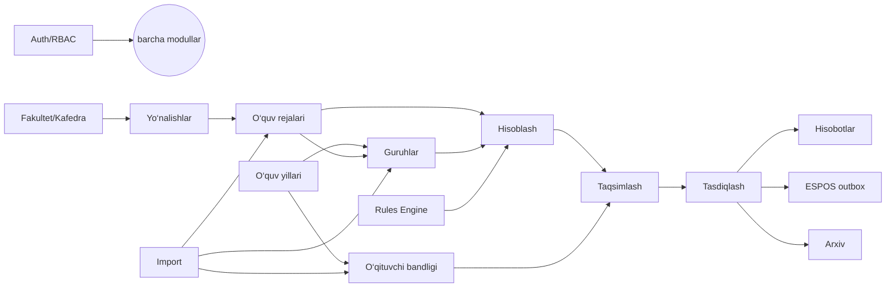

# 2. Platforma modullari

| # | Modul | Asosiy vazifa | Asosiy jadvallar | Bosqich |
|---|---|---|---|---|
| M1 | **Auth** | Kirish, chiqish, refresh, parolni tiklash, sessiyalar | `users`, `refresh_tokens` | 1 |
| M2 | **Tenants (SaaS)** | Universitetlar, tariflar, obunalar, limitlar | `universities`, `subscriptions`, `plans` | 1 / 5 |
| M3 | **Foydalanuvchilar va rollar** | Foydalanuvchilar, rollar, ruxsatlar, ko‘lam (universitet/fakultet/kafedra) | `roles`, `permissions`, `user_roles` | 1 |
| M4 | **Boshqaruv paneli** | Statistik kartalar, grafiklar, ogohlantirishlar | (agregatlar, Redis kesh) | 1 → har bosqichda boyitiladi |
| M5 | **O‘quv yillari** | Yil yaratish (bo‘sh / nusxa), holatlar, semestrlar, yillarni solishtirish | `academic_years`, `semesters`, `year_copy_jobs` | 1 |
| M6 | **Tashkiliy tuzilma** | Fakultetlar, kafedralar | `faculties`, `departments` | 2 |
| M7 | **Ta’lim yo‘nalishlari** | Yo‘nalish/mutaxassislik, daraja, ta’lim shakli | `education_programs` | 2 |
| M8 | **O‘quv rejalari va fanlar** | Fanlar katalogi, o‘quv reja versiyalari, semestr va mashg‘ulot turlari bo‘yicha soatlar | `subjects`, `curricula`, `curriculum_subjects`, `curriculum_subject_hours`, `lesson_types` | 2 |
| M9 | **Akademik guruhlar** | Guruhlar, kontingent, kichik guruhlar, oqimlar | `student_groups`, `streams`, `stream_groups` | 2 |
| M10 | **Professor-o‘qituvchilar** | O‘qituvchi profili, yillik bandlik (lavozim, stavka), me’yorlar | `teachers`, `teacher_employment`, `position_norms` | 2 |
| M11 | **Import** | Excel import (moslashtirish → tekshirish → ko‘rish → tasdiqlash), PDF tahlil, import tarixi | `import_jobs`, `import_job_rows`, `rule_candidates`, `files` | 3 (PDF — 3/4) |
| M12 | **Hisoblash qoidalari (Rules Engine)** | Versiyali qoidalar, xavfsiz formula DSL, sinov (sandbox), faollashtirish | `workload_rules` | 3 |
| M13 | **Yuklamani shakllantirish** | Hisoblash yugurishlari, natijalar, “nega shuncha soat” izohi, oldingi yil bilan farq | `workload_calculations`, `workload_items` | 3 |
| M14 | **Yuklamani taqsimlash** | Drag-and-drop / jadval, validatsiyalar, tavsiyalar (oldingi yil asosida) | `workload_assignments` | 3 |
| M15 | **Tasdiqlash** | Moslashtiriladigan bosqichli tasdiqlash, qaytarish, izohlar, override | `approval_workflows`, `approvals` | 4 |
| M16 | **Hisobotlar** | 9 ta standart hisobot, Excel/PDF eksport, universitet shablonlari | `report_templates`, `report_jobs` | 4 |
| M17 | **Arxivlash** | Yilni arxivlash, faqat o‘qish rejimi, eksport paketi | (`academic_years.status`) | 4 |
| M18 | **ESPOS integratsiyasi** | Adapter, mock API, outbox, qayta urinish, ID moslashtirish | `integration_events`, `external_mappings` | 5 |
| M19 | **Audit** | Barcha muhim o‘zgarishlar jurnali, qidiruv, eksport | `audit_logs` | 1 (yozish), 4 (UI) |
| M20 | **Sozlamalar** | Universitet profili, tasdiqlash zanjiri, me’yorlar, mashg‘ulot turlari, til | `universities.settings`, `position_norms`, `lesson_types` | 1 → 4 |
| M21 | **Platforma (Super Admin)** | Universitetlar ro‘yxati, obunalar, tizim holati, support-kirish | `universities`, `subscriptions` | 1 (minimal), 5 |

## Modullar o‘rtasidagi bog‘liqlik

