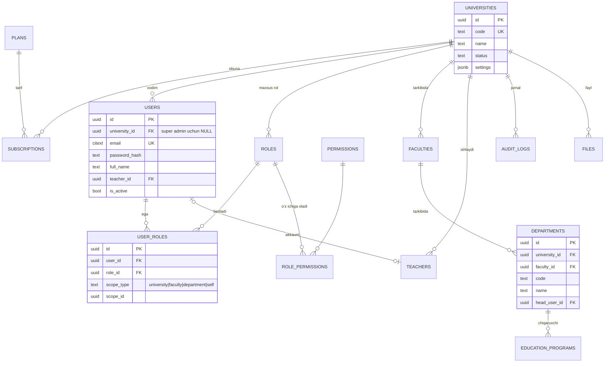
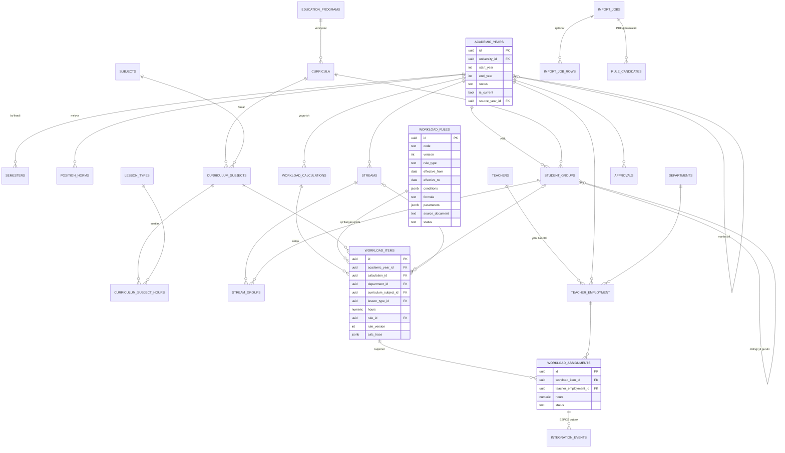

# 3. Ma’lumotlar bazasining ER modeli

## 3.1. Umumiy qoidalar

**Har bir tenant jadvalidagi standart maydonlar:**

| Maydon | Tip | Izoh |
|---|---|---|
| `id` | `uuid` PK | UUID v7 |
| `university_id` | `uuid` NOT NULL FK → `universities.id` | Tenant; RLS siyosati shu maydon bo‘yicha |
| `created_at`, `updated_at` | `timestamptz` NOT NULL | `DEFAULT now()` |
| `created_by`, `updated_by` | `uuid` FK → `users.id` | NULL faqat tizim/seed uchun |
| `deleted_at` | `timestamptz` NULL | Soft-delete (ma’lumotnomalar uchun); yuklama yozuvlari o‘chirilmaydi |
| `row_version` | `int` NOT NULL DEFAULT 1 | Optimistik qulf |

**Yilga bog‘liq jadvallar** qo‘shimcha `academic_year_id` va kompozit FK `(university_id, academic_year_id) → academic_years(university_id, id)` ga ega.

**Konvensiyalar:** soatlar `NUMERIC(10,2)`, holatlar PostgreSQL `ENUM` emas, `text + CHECK` (migratsiyada o‘zgartirish oson), noyob kodlar uchun `lower()` yoki `citext`.

## 3.2. ER diagramma — tenant, foydalanuvchilar, tuzilma

## 3.3. ER diagramma — o‘quv jarayoni va yuklama

## 3.4. Jadvallar spetsifikatsiyasi

> Belgilar: **PK** — birlamchi kalit, **FK** — tashqi kalit, **UK** — noyoblik, **CK** — CHECK, **IX** — indeks. Standart audit maydonlari (3.1) har bir jadvalda bor va qayta yozilmagan.

### Tenant va SaaS

**`universities`** — tenantning o‘zi (`university_id` maydoni yo‘q)
- `code` text UK, `name`, `short_name`, `stir` (INN), `status` CK ∈ {`active`,`suspended`,`closed`}, `default_locale` CK ∈ {`uz`,`ru`,`en`}, `settings` jsonb (tasdiqlash zanjiri, chetlanish chegarasi %, yaxlitlash qoidasi).
- IX: `status`.

**`plans`** — tariflar katalogi (platforma darajasi): `code` UK, `name`, `limits` jsonb (`max_users`, `max_teachers`, `features`), `price_monthly`.

**`subscriptions`**
- FK `university_id`, FK `plan_id`; `status` CK ∈ {`trial`,`active`,`past_due`,`canceled`}; `starts_at`, `ends_at`.
- CK `ends_at > starts_at`; **partial UK** `(university_id) WHERE status IN ('trial','active')` — bir vaqtda bitta faol obuna.

### Foydalanuvchilar va ruxsatlar

**`users`**
- `university_id` NULL bo‘lishi mumkin faqat `is_platform_admin = true` bo‘lsa (CK).
- `email` citext UK (platforma bo‘yicha), `password_hash`, `full_name`, `phone`, `locale`, `is_active`, `failed_login_count`, `locked_until`, `last_login_at`, `teacher_id` FK NULL UK.
- IX: `(university_id, is_active)`.

**`refresh_tokens`** — `user_id` FK, `token_hash` UK, `family_id` (rotatsiya zanjiri), `expires_at`, `revoked_at`, `ip`, `user_agent`. IX `(user_id, revoked_at)`.

**`roles`** — `university_id` NULL = tizim shabloni; `code`, `name`, `is_system`. UK `(university_id, code)` (`NULLS NOT DISTINCT`).

**`permissions`** — tizim katalogi: `code` UK (masalan `workload.distribute`), `module`, `description`.

**`role_permissions`** — PK `(role_id, permission_id)`.

**`user_roles`** — `user_id`, `role_id`, `university_id`, `scope_type` CK ∈ {`platform`,`university`,`faculty`,`department`,`self`}, `scope_id` NULL; CK: `scope_type IN ('platform','university','self') ↔ scope_id IS NULL`; UK `(user_id, role_id, scope_type, scope_id)`.

### Tashkiliy tuzilma

**`faculties`** — `code`, `name`, `is_active`. UK `(university_id, lower(code))`.

**`departments`** — FK `(university_id, faculty_id) → faculties(university_id, id)`, `code`, `name`, `head_user_id` FK NULL, `is_active`. UK `(university_id, lower(code))`; IX `faculty_id`.

> Fakultet/kafedralar tenant darajasida saqlanadi (yilga bog‘lanmaydi), chunki ular kamdan-kam o‘zgaradi. Kafedra yopilsa yoki birlashsa — `is_active=false` va `merged_into_id`; o‘tgan yillar yozuvlari eski kafedraga bog‘langanicha qoladi.

**`education_programs`** — FK `department_id` (chiqaruvchi kafedra), `code` (masalan `60610100`), `name`, `degree` CK ∈ {`bachelor`,`master`}, `duration_years` CK 1..6, `is_active`. UK `(university_id, code, degree)`.

### O‘quv yillari

**`academic_years`**
- `start_year` int, `end_year` int, `label` (generated: `'2026–2027'`), `status` CK ∈ {`draft`,`calculated`,`distributing`,`in_review`,`approved`,`archived`}, `is_current` bool, `source_year_id` FK self NULL, `starts_on`, `ends_on`, `approved_at`, `approved_by`.
- CK `end_year = start_year + 1`; UK `(university_id, start_year)`; UK `(university_id, id)` (kompozit FK’lar uchun); **partial UK** `(university_id) WHERE is_current`.

**`semesters`** — `academic_year_id`, `term` CK ∈ {1,2} (kuzgi/bahorgi), `starts_on`, `ends_on`, `weeks`. UK `(academic_year_id, term)`.

**`position_norms`** — yillik me’yorlar: `academic_year_id`, `position_code` (assistent, katta o‘qituvchi, dotsent, professor, kafedra mudiri …), `norm_hours_per_rate` NUMERIC, `max_overload_pct`, `source_document`. UK `(academic_year_id, position_code)`.
> Qiymatlar universitet me’yoriy hujjatidan kiritiladi; demo seed’da “DEMO” belgisi bilan.

**`year_copy_jobs`** — `source_year_id`, `target_year_id`, `options` jsonb, `status`, `report` jsonb (nima ko‘chirildi/o‘tkazib yuborildi), `id_map` (alohida `year_copy_map` jadvalida: `entity_type`, `source_id`, `target_id`).

### O‘quv rejalari va fanlar

**`lesson_types`** — `code` CK ∈ {`lecture`,`practice`,`lab`,`seminar`,`independent`,`course_work`,`course_project`,`internship`,`final_control`,`graduation_work`,`other`} + universitet qo‘shimcha turlari; `name`, `is_auditorium`, `counts_in_workload`, `sort_order`. UK `(university_id, code)`.

**`subjects`** — fanlar katalogi: `code`, `name_uz`, `name_ru`, `name_en`, `default_department_id` FK. UK `(university_id, lower(code))`; IX trigram `name_uz` (qidiruv uchun).

**`curricula`** — `education_program_id` FK, `education_form` CK ∈ {`full_time`,`part_time`,`evening`,`distance`}, `admission_year` int, `version` int, `status` CK ∈ {`draft`,`approved`,`archived`}, `approval_doc` (raqam, sana), `total_credits`.
- UK `(university_id, education_program_id, education_form, admission_year, version)`.
- `approved` holatdagi rejani o‘zgartirib bo‘lmaydi (trigger) — yangi versiya yaratiladi.

**`curriculum_subjects`** — `curriculum_id`, `subject_id`, `semester_no` CK 1..12, `credits` NUMERIC(5,1), `department_id` (o‘qitadigan kafedra), `control_type` CK ∈ {`exam`,`credit_test`,`none`}, `is_elective`, `elective_group`.
- UK `(curriculum_id, subject_id, semester_no)`; IX `department_id`.

**`curriculum_subject_hours`** — `curriculum_subject_id`, `lesson_type_id`, `hours` NUMERIC(10,2) CK ≥ 0. UK `(curriculum_subject_id, lesson_type_id)`.

### Guruhlar va oqimlar

**`student_groups`** — `academic_year_id`, `curriculum_id` FK, `code`, `course` CK 1..6, `education_form`, `language` CK ∈ {`uz`,`ru`,`en`,`kk`,`tj`…}, `student_count` CK ≥ 0, `budget_count`, `contract_count`, `subgroup_count` CK ≥ 1, `source_group_id` FK self NULL (oldingi yildagi shu guruh), `needs_review` bool (nusxalangandan keyin kontingent yangilanmagan).
- UK `(academic_year_id, lower(code))`; CK `budget_count + contract_count = student_count` (agar ikkalasi kiritilgan bo‘lsa); IX `(academic_year_id, curriculum_id, course)`.

**`streams`** — oqim: `academic_year_id`, `semester_id`, `subject_id`, `lesson_type_id`, `name`. IX `(academic_year_id, subject_id)`.
**`stream_groups`** — PK `(stream_id, group_id)`; trigger: guruh va oqim bir xil yilda bo‘lishi shart.

### Professor-o‘qituvchilar

**`teachers`** — `last_name`, `first_name`, `middle_name`, `employee_no`, `academic_degree` CK ∈ {`none`,`phd`,`dsc`,`candidate`,`doctor`}, `academic_title` CK ∈ {`none`,`docent`,`professor`, …}, `email`, `is_active`. UK `(university_id, employee_no)`.

**`teacher_employment`** — yillik bandlik: `academic_year_id`, `teacher_id`, `department_id`, `position_code`, `employment_type` CK ∈ {`main`,`internal_part_time`,`external_part_time`,`hourly`}, `rate` NUMERIC(4,2) CK > 0, `norm_hours` NUMERIC (snapshot: `rate × position_norms`), `starts_on`, `ends_on`.
- UK `(academic_year_id, teacher_id, department_id, employment_type)`; IX `(academic_year_id, department_id)`.

### Hisoblash

**`workload_rules`** — Rules Engine qoidasi (batafsil: [06-hisoblash-taqsimlash.md](06-hisoblash-taqsimlash.md))
- `code`, `name`, `rule_type` CK ∈ {`auditorium`,`course_work`,`internship`,`final_control`,`graduation`,`consultation`,`other`}, `version` int, `effective_from` date, `effective_to` date NULL, `priority` int, `conditions` jsonb (qachon qo‘llanadi), `formula` text (xavfsiz DSL), `parameters` jsonb, `source_document` text + `source_file_id` FK, `status` CK ∈ {`draft`,`testing`,`active`,`retired`}, `is_demo` bool, `approved_by`, `approved_at`.
- UK `(university_id, code, version)`; **EXCLUDE** (btree_gist) — bir `code` uchun `active` versiyalarning amal qilish davrlari kesishmasin; `active` qoidani tahrirlash taqiqlangan (faqat yangi versiya).

**`workload_calculations`** — hisoblash yugurishi: `academic_year_id`, `scope_type`, `scope_id`, `status` CK ∈ {`queued`,`running`,`succeeded`,`failed`,`superseded`}, `rules_snapshot` jsonb (`[{rule_id, version}]`), `inputs_hash`, `totals` jsonb, `error`, `started_at`, `finished_at`, `is_current` bool.
- partial UK `(academic_year_id, scope_type, scope_id) WHERE is_current`.

**`workload_items`** — hisoblangan yuklama birligi (taqsimlanadigan “bo‘lak”): `academic_year_id`, `calculation_id`, `semester_id`, `department_id`, `curriculum_subject_id`, `subject_id`, `lesson_type_id`, `group_id` NULL, `stream_id` NULL, `education_form`, `course`, snapshot maydonlar (`plan_hours`, `student_count`, `groups_count`, `subgroups_count`), `hours` NUMERIC(10,2) CK ≥ 0, `rule_id`, `rule_version`, `calc_trace` jsonb, `item_key` (barqaror kalit: qayta hisoblashda taqsimotni saqlab qolish uchun).
- CK `NOT (group_id IS NOT NULL AND stream_id IS NOT NULL)` (bo‘lak yo guruhga, yo oqimga, yo umumiy — BMI, amaliyot rahbarligi kabi); UK `(calculation_id, item_key)`; IX `(academic_year_id, department_id)`, `(academic_year_id, subject_id)`.

### Taqsimot va tasdiqlash

**`workload_assignments`** — `academic_year_id`, `workload_item_id`, `teacher_employment_id`, `teacher_id` (denormalizatsiya, indeks uchun), `hours` NUMERIC(10,2) CK > 0, `status` CK ∈ {`draft`,`submitted`,`approved`,`revoked`}, `note`.
- UK `(workload_item_id, teacher_id)` — takroriy biriktirish yo‘q.
- Deferred constraint trigger: `SUM(hours) per item ≤ item.hours`.
- IX `(academic_year_id, teacher_id)`, `(academic_year_id, status)`.

**`approval_workflows`** — `object_type`, `steps` jsonb (`[{step:1, role:"department_head"}, {step:2, role:"academic_office"}, …]`), `is_active`.

**`approvals`** — `academic_year_id`, `object_type` CK ∈ {`department_distribution`,`year_workload`,`override_request`}, `object_id`, `step_no`, `required_permission`, `status` CK ∈ {`pending`,`approved`,`rejected`,`returned`,`canceled`}, `submitted_by/at`, `decided_by/at`, `comment`, `snapshot_hash` (tasdiqlangan holatning xeshi).
- partial UK `(object_type, object_id, step_no) WHERE status = 'pending'`; IX `(university_id, status, required_permission)`.

### Import

**`files`** — `storage_key` UK, `original_name`, `mime`, `size_bytes`, `sha256`, `uploaded_by`. IX `(university_id, sha256)` (takroriy yuklashni aniqlash).

**`import_jobs`** — `academic_year_id` NULL, `import_type` CK ∈ {`curriculum_xlsx`,`groups_xlsx`,`teachers_xlsx`,`workload_pdf`,`workload_xlsx`}, `file_id`, `status` CK ∈ {`uploaded`,`parsing`,`mapping`,`validated`,`committed`,`failed`,`canceled`}, `column_mapping` jsonb, `stats` jsonb, `error_count`, `committed_at`, `committed_by`.

**`import_job_rows`** — `job_id`, `row_no`, `raw` jsonb, `normalized` jsonb, `errors` jsonb, `status` CK ∈ {`valid`,`warning`,`invalid`,`skipped`}, `target_entity_id`. UK `(job_id, row_no)`.

**`rule_candidates`** — PDF tahlilidan topilgan qonuniyat gipotezalari: `job_id`, `description`, `proposed_formula`, `match_rate` (necha qatorga mos keldi), `sample_rows` jsonb, `status` CK ∈ {`proposed`,`rejected`,`converted_to_draft`}, `reviewed_by`. **Hech qachon avtomatik `active` qoida bo‘lmaydi.**

### Integratsiya va audit

**`external_mappings`** — `system` ('espos'), `entity_type` (teacher/department/subject), `entity_id`, `external_id`. UK `(university_id, system, entity_type, entity_id)`, UK `(university_id, system, entity_type, external_id)`.

**`integration_events`** — outbox: `system`, `event_type` (`workload.upserted`, `workload.revoked`), `aggregate_id`, `idempotency_key` UK, `revision` int, `payload` jsonb, `status` CK ∈ {`pending`,`sending`,`sent`,`acknowledged`,`failed`,`dead`,`blocked`}, `attempts`, `next_attempt_at`, `last_error`, `external_ref`.
- IX `(status, next_attempt_at)`.

**`audit_logs`** — `id` bigint identity, `university_id` NULL, `occurred_at`, `actor_user_id`, `actor_ip`, `request_id`, `action`, `entity_type`, `entity_id`, `academic_year_id`, `before` jsonb, `after` jsonb, `reason`.
- `occurred_at` bo‘yicha oylik partitsiya; IX `(university_id, entity_type, entity_id)`, `(university_id, occurred_at DESC)`. Faqat `INSERT`.

## 3.5. Yaxlitlikni ta’minlovchi triggerlar

| Trigger | Jadvallar | Vazifa |
|---|---|---|
| `trg_year_lock` | barcha yilga bog‘liq jadvallar | Yil `approved`/`archived` bo‘lsa, `app.override_reason` bo‘lmasa o‘zgartirishni rad etadi |
| `trg_curriculum_lock` | `curricula`, `curriculum_subjects`, `curriculum_subject_hours` | Tasdiqlangan reja o‘zgarmaydi |
| `trg_rule_lock` | `workload_rules` | `active` qoida formulasini tahrirlab bo‘lmaydi |
| `trg_assignment_sum` (deferred) | `workload_assignments` | Bo‘lak bo‘yicha taqsimot jami soatdan oshmaydi |
| `trg_same_year` | `stream_groups`, `workload_assignments` | Bog‘langan yozuvlar bir xil o‘quv yilida |
| `trg_touch` | hammasi | `updated_at`, `row_version++` |
