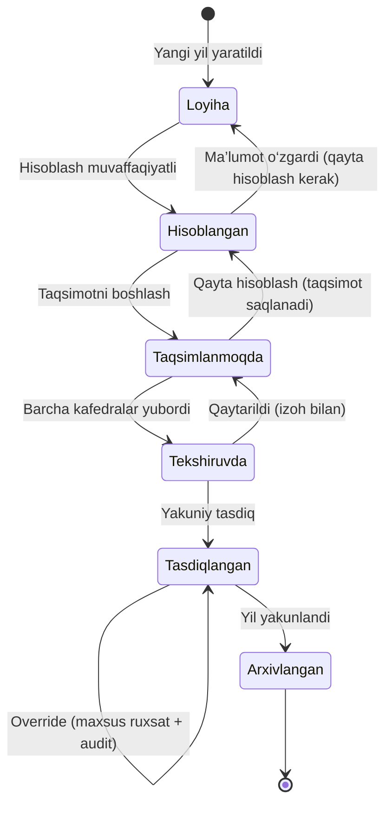

# 5. O‘quv yilini yaratish algoritmi

## 5.1. Holatlar diagrammasi



| Holat | Kod | Nima qilish mumkin |
|---|---|---|
| Loyiha | `draft` | Guruhlar, kontingent, bandlik, oqimlarni tahrirlash; hisoblash |
| Hisoblangan | `calculated` | Natijalarni ko‘rish, solishtirish; qayta hisoblash |
| Taqsimlanmoqda | `distributing` | Kafedralar o‘qituvchilarga biriktiradi |
| Tekshiruvda | `in_review` | Faqat tasdiqlovchilar; tahrir yopiq |
| Tasdiqlangan | `approved` | Faqat o‘qish; override; ESPOS’ga uzatish |
| Arxivlangan | `archived` | Faqat o‘qish va eksport |

Har bir o‘tish: ruxsat tekshiruvi → oldindan shartlar (masalan, `in_review` uchun taqsimlanmagan soat = 0 yoki ruxsat etilgan chetlanish ichida) → audit → bildirishnoma.

## 5.2. “Yangi o‘quv yili yaratish” ustasi (wizard)

1. **Yilni tanlash** — tizim keyingi yilni taklif qiladi (`2027–2028`); bir xil yil mavjud bo‘lsa — xato.
2. **Rejim** — `Bo‘sh yil` yoki `Oldingi yildan nusxalash` (manba: istalgan mavjud yil, sukut bo‘yicha joriy yil).
3. **Nimalarni ko‘chirish** (nusxalash rejimida, belgilash katakchalari):

| Ma’lumot | Sukut | Ko‘chirish usuli |
|---|---|---|
| Semestrlar | har doim | Yangi sanalar bilan qayta yaratiladi (nusxa emas) |
| Lavozim me’yorlari (`position_norms`) | ✅ | Qiymatlar nusxalanadi, “tekshirish kerak” belgisi |
| O‘qituvchilar bandligi (lavozim, stavka) | ✅ | Faol o‘qituvchilar uchun nusxa; muddati tugaganlar o‘tkazib yuboriladi |
| Akademik guruhlar | ✅ | **Kursni ko‘tarish**: `course + 1`; bitiruvchi guruhlar (`course = duration_years`) ko‘chirilmaydi; kontingent nusxalanadi va `needs_review = true` |
| Yangi 1-kurs guruhlari | ☐ | Qabul rejasidan qo‘lda/Excel orqali; eng so‘nggi tasdiqlangan o‘quv reja versiyasiga bog‘lanadi |
| Oqimlar | ✅ | Tuzilma yangi guruh ID’lari bilan qayta quriladi (mapping orqali) |
| Taqsimot (kim nimani o‘qitgan) | ☐ | **To‘g‘ridan-to‘g‘ri ko‘chirilmaydi.** Hisoblashdan keyin “oldingi yil bo‘yicha tavsiya” sifatida taklif qilinadi |
| Hisoblash qoidalari | — | Ko‘chirilmaydi: tenant darajasida, `effective_from/to` bo‘yicha yangi yilga avtomatik tanlanadi. Yangi yil sanasiga mos faol qoida bo‘lmasa — ogohlantirish |
| Hisoblangan yuklama | — | Hech qachon ko‘chirilmaydi — har doim qayta hisoblanadi |

4. **Oldindan ko‘rish** — necha guruh ko‘chiriladi, nechta bitiruvchi guruh tushib qoladi, qaysi o‘quv rejalari ishlatiladi, ogohlantirishlar.
5. **Tasdiqlash oynasi** → fon vazifasi (`year_copy_jobs`) ishga tushadi → natija hisoboti.

## 5.3. Algoritm (psevdokod)

```python
def create_academic_year(ctx, start_year: int, mode: Literal["empty", "copy"],
                         source_year_id: UUID | None, options: CopyOptions) -> AcademicYear:
    require_permission(ctx, "academic_year.create")
    validate(start_year not in existing_years(ctx.university_id))
    if mode == "copy":
        source = get_year(ctx, source_year_id)            # faqat o‘qiladi
        validate(source.status in {"calculated", "distributing", "in_review",
                                   "approved", "archived"} or options.allow_draft_source)

    with transaction():                                   # hammasi yoki hech narsa
        year = AcademicYear(start_year=start_year, end_year=start_year + 1,
                            status="draft", source_year_id=source_year_id)
        create_semesters(year, default_calendar(ctx.settings, start_year))
        id_map = IdMap()

        if mode == "copy":
            if options.norms:
                copy_rows(PositionNorm, source, year, id_map, mark_review=True)

            if options.employment:
                for emp in active_employment(source):
                    if teacher_is_active(emp.teacher_id):
                        id_map.add(emp, insert(emp.clone(year, norm_hours=recompute_norm(emp, year))))

            if options.groups:
                for g in groups(source):
                    duration = g.curriculum.program.duration_years
                    if g.course >= duration:              # bitiruvchi
                        report.skipped_graduates.append(g); continue
                    new_g = g.clone(year, course=g.course + 1,
                                    source_group_id=g.id, needs_review=True)
                    id_map.add(g, insert(new_g))

            if options.streams:
                for s in streams(source):
                    groups_new = [id_map[g] for g in s.groups if g in id_map]
                    if groups_new:
                        insert(s.clone(year, semester=map_semester(s.semester, year),
                                       groups=groups_new))

        check_rules_coverage(year)                        # faol qoidalar bormi?
        audit(ctx, "academic_year.created", year, details={"mode": mode, "report": report})
    return year
```

**Kafolatlar:**
- Manba yil faqat `SELECT` qilinadi. Integration test: nusxalashdan oldin va keyin manba yil ma’lumotlarining xeshi bir xil.
- Barcha yangi qatorlar yangi `id` va yangi `academic_year_id` bilan; `year_copy_map` orqali qaysi qator qaysidan olingani kuzatiladi.
- Takroriy bosish: `Idempotency-Key` — ikki marta yil yaratilmaydi.

## 5.4. Guruh semestrini aniqlash

Guruh `course = k` bo‘lsa, shu o‘quv yilida o‘quv rejaning `semester_no ∈ {2k−1, 2k}` fanlari o‘qitiladi:
- kuzgi semestr (`term = 1`) → `semester_no = 2k − 1`;
- bahorgi semestr (`term = 2`) → `semester_no = 2k`.

> Sirtqi/kechki shakllar yoki noodatiy reja tuzilmasi uchun bu xarita universitet sozlamasida o‘zgartiriladi.

## 5.5. Yillarni solishtirish

Yangi yil hisoblangandan keyin `GET /academic-years/{id}/compare?with={old_id}`:

| Bo‘lim | Ko‘rsatiladi |
|---|---|
| Fanlar | yangi qo‘shilgan / olib tashlangan / semestri o‘zgargan |
| Soatlar | o‘quv reja soati o‘zgargan fanlar (eski → yangi, Δ) |
| Kontingent | guruhlar soni, talabalar soni bo‘yicha farq |
| Yuklama | kafedra, fakultet, mashg‘ulot turi bo‘yicha jami soat Δ va % |
| O‘qituvchilar | yangi kelgan / ketgan, stavkasi o‘zgargan |

Moslashtirish kaliti: `subject_id + lesson_type + group lineage (source_group_id)`.
