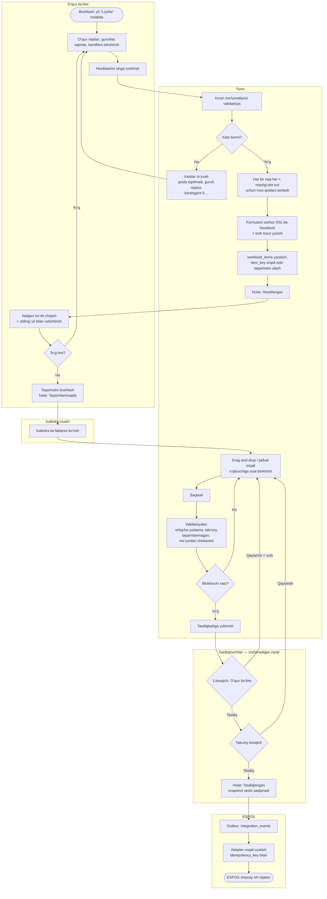
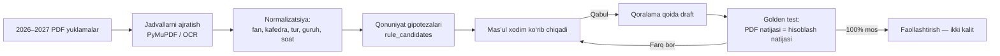

# 6. Yuklamani hisoblash va taqsimlash jarayoni

## 6.1. Umumiy jarayon (BPMN uslubidagi flowchart)

## 6.2. Calculation Rules Engine

### Qoida tuzilmasi

| Maydon | Misol (faqat sintaksis namunasi) |
|---|---|
| `code` | `AUD_LECTURE` |
| `name` | “Ma’ruza mashg‘uloti yuklamasi” |
| `rule_type` | `auditorium` |
| `version` | `1` |
| `effective_from` / `effective_to` | `2026-09-01` / `NULL` |
| `priority` | `100` (bir nechta qoida mos kelsa, kattasi g‘olib; teng bo‘lsa — xato) |
| `conditions` | `{"lesson_type": "lecture", "education_form": ["full_time"], "degree": "bachelor"}` |
| `formula` | `plan_hours * streams_count` ← **namuna, haqiqiy formula emas** |
| `parameters` | `{"k": null}` — qiymatlar hujjatdan kiritiladi |
| `source_document` | “Universitet buyrug‘i №…, sana …, 3-ilova, 5-band” |
| `status` | `draft` → `testing` → `active` → `retired` |

> ⚠️ **Haqiqiy formulalar va koeffitsiyentlar hozircha kiritilmaydi.** Ular 2026–2027 o‘quv yili PDF yuklamalari va tasdiqlangan me’yoriy hujjatlar tahlilidan keyin aniqlanadi. Demo uchun yaratilgan qoidalar `is_demo = true` bilan belgilanadi va UI’da “DEMO” yorlig‘i bilan ko‘rsatiladi.

### Formula DSL

- Faqat ruxsat etilgan elementlar: sonlar, `+ − × ÷`, qavslar, taqqoslash, `if(shart, a, b)`, `min`, `max`, `round(x, n)`, `ceil`, `floor`, `sum` va kontekst o‘zgaruvchilari.
- Python `eval` **ishlatilmaydi** — o‘zimizning AST parser (whitelist), vaqt va chuqurlik chegarasi bilan.
- Qoida saqlanayotganda: sintaksis, noma’lum o‘zgaruvchilar va birliklar tekshiriladi.

**Kontekst o‘zgaruvchilari** (hisoblash har bir `reja-fan × mashg‘ulot turi × guruh/oqim` uchun):
`plan_hours`, `credits`, `semester_no`, `course`, `education_form`, `degree`, `language`, `groups_count`, `subgroups_count`, `streams_count`, `student_count`, `weeks`, `control_type`, `has_course_work`, `is_elective` + qoidaning `parameters`.

### Hisoblash bosqichlari

1. **To‘plash:** yildagi har bir guruh → uning o‘quv rejasi → shu yil semestrlariga to‘g‘ri keladigan `curriculum_subjects` (5.4) → `curriculum_subject_hours`.
2. **Guruhlash:** oqimlar bo‘yicha birlashtirish (ma’ruza oqimga bir marta), kichik guruhlar (laboratoriya) bo‘yicha bo‘lish — **qaysi turi qanday birlashishi ham qoida bilan belgilanadi** (`grouping`: `per_group` | `per_stream` | `per_subgroup` | `per_student` | `fixed`).
3. **Qoida tanlash:** `conditions` mos keladigan, yil sanasiga amal qiladigan, `active` qoidalar; aniq bitta g‘olib. Topilmasa — **xato** (jimgina 0 yoki “oddiy qo‘shish” yo‘q).
4. **Hisoblash:** formula → `hours` (`NUMERIC`, universitet yaxlitlash sozlamasi bo‘yicha).
5. **Izoh (trace):** `{"rule":"AUD_LECTURE@v1","inputs":{"plan_hours":36,"streams_count":2},"formula":"...","result":72}` — UI’da “Bu soat qanday hisoblandi?” oynasi.
6. **Barqaror kalit:** `item_key = hash(curriculum_subject, lesson_type, group|stream lineage)` — qayta hisoblashda mavjud taqsimotlar yangi bo‘laklarga ko‘chiriladi; soat kamaygan bo‘lsa — “qayta ko‘rib chiqish kerak” ogohlantirishi.

### PDF asosida formulalarni aniqlash va tekshirish (3-bosqich)

**Golden testlar:** PDF’dan olingan har bir qator test ma’lumotiga aylantiriladi; hisoblash engine’i natijasi bilan **0 farq** talab qilinadi. Farq bo‘lsa — hisobot: qaysi qator, kutilgan/olingan, qaysi qoida.

## 6.3. Taqsimlash algoritmi (qoidalarga asoslangan)

### Validatsiyalar

| Tekshiruv | Shart | Darajasi |
|---|---|---|
| Ortiqcha taqsimot | `Σ assignments(item) > item.hours` | ❌ bloklaydi (DB ham) |
| Takroriy biriktirish | bir o‘qituvchi bir bo‘lakka ikki marta | ❌ bloklaydi (UK) |
| O‘qituvchi ortiqcha yuklamasi | `Σ hours(employment) > norm_hours × (1 + max_overload_pct)` | ❌ yoki ⚠️ — sozlamaga bog‘liq |
| Me’yordan kam yuklama | `Σ hours < norm_hours × min_pct` | ⚠️ |
| Jami bandlik (bir nechta kafedra) | o‘qituvchining barcha bandliklari bo‘yicha jami | ⚠️ |
| Taqsimlanmagan soat | `item.hours − Σ assignments > 0` | ⚠️, yuborishda ❌ (chetlanish chegarasidan tashqari) |
| Kafedraga tegishlilik | o‘qituvchi bandligi boshqa kafedrada | ⚠️ / ❌ sozlamaga ko‘ra |
| Malaka (ixtiyoriy) | fan o‘qituvchining fanlar ro‘yxatida yo‘q | ⚠️ |
| Ma’ruza huquqi (ixtiyoriy) | assistent ma’ruzaga biriktirildi | ⚠️ — sozlama |

### Tavsiya (avtomatik emas, faqat taklif)

1. **Oldingi yil asosida:** shu fan × tur × guruh lineage bo‘yicha o‘tgan yili kim o‘qitgan bo‘lsa va hozir bandligi bor bo‘lsa — taklif.
2. **Qolgan bo‘laklar:** kafedra o‘qituvchilari orasidan bo‘sh hajmi eng katta, malakasi mos keladigan — greedy algoritm; cheklovlar buzilsa taklif qilinmaydi.
3. Foydalanuvchi takliflarni bittalab yoki to‘plab qabul qiladi. AI tavsiya moduli keyingi bosqichda shu interfeysga ulanadi.

### Bir vaqtda ishlash
- Har bir saqlash `row_version` bilan; to‘qnashuvda UI “ma’lumot boshqa foydalanuvchi tomonidan o‘zgartirildi” va farqni ko‘rsatadi.
- Kafedra taqsimoti yuborilgandan keyin (`submitted`) kafedra uchun tahrir yopiladi, qaytarilsa ochiladi.
