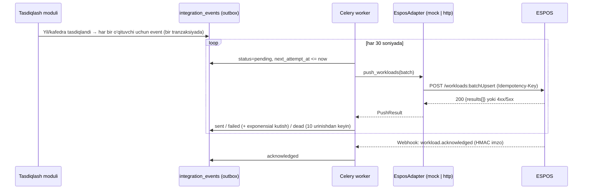

# 9. ESPOS integratsiya kontrakti (loyiha)

> ⚠️ **Holat: taklif.** ESPOS API hujjatlari hali taqdim etilmagan, shuning uchun quyidagilar UniLoad tomonidan taklif qilinayotgan kontrakt. Haqiqiy integratsiya mavjud deb hisoblanmaydi: avval **adapter interfeysi** va **mock API** yaratiladi. ESPOS hujjatlari kelgach, faqat `HttpEsposAdapter` implementatsiyasi va maydonlar xaritasi o‘zgaradi — qolgan tizim o‘zgarmaydi.

## 9.1. Arxitektura



**Outbox pattern** — event tasdiqlash bilan bitta tranzaksiyada yoziladi, shuning uchun “tasdiqlandi, lekin ESPOS’ga ketmadi” holati yo‘qolmaydi.

## 9.2. Adapter interfeysi (backend port)

```python
class EsposAdapter(Protocol):
    async def health(self) -> HealthStatus: ...
    async def push_workloads(self, batch: WorkloadBatch) -> PushResult: ...
    async def revoke_workloads(self, record_keys: list[str], reason: str) -> PushResult: ...
    async def get_batch_status(self, batch_id: str) -> BatchStatus: ...
    async def resolve_teacher(self, university_ext_id: str, query: TeacherLookup) -> list[EsposTeacher]: ...

# Implementatsiyalar:
#   MockEsposAdapter  — docker-compose’dagi espos-mock servisiga (yoki xotiradagi) ulanadi
#   HttpEsposAdapter  — ESPOS hujjatlari kelgach yoziladi
```

## 9.3. Uzatiladigan ma’lumot (payload)

```json
{
  "batch_id": "0192f6e0-7c1a-7b3e-9a52-1f2d3c4b5a69",
  "source": "uniload",
  "schema_version": "1.0",
  "university": { "uniload_id": "…", "espos_id": "UNI-001" },
  "academic_year": "2026-2027",
  "generated_at": "2027-06-20T10:15:00+05:00",
  "records": [
    {
      "record_key": "c3f1…e9",
      "revision": 1,
      "operation": "upsert",
      "teacher":    { "uniload_id": "…", "espos_id": "T-10234", "employee_no": "DEMO-0042" },
      "department": { "uniload_id": "…", "espos_id": "D-17", "name": "Axborot texnologiyalari" },
      "subject":    { "code": "AT1204", "name": "Ma’lumotlar bazasi" },
      "semester": 1,
      "lesson_type": "lecture",
      "groups": ["DEMO-KI-21", "DEMO-KI-22"],
      "stream": "Oqim-1",
      "hours": 72.00,
      "approval": {
        "status": "approved",
        "approved_at": "2027-06-19T16:40:00+05:00",
        "approved_by": "O‘quv bo‘limi",
        "snapshot_hash": "sha256:…"
      }
    }
  ]
}
```

| Maydon | Majburiy | Izoh |
|---|---|---|
| `university.espos_id` | ✅ | Universitet identifikatori |
| `teacher.espos_id` | ✅ | `external_mappings` orqali; topilmasa event `blocked` holatda, UI’da “moslashtirish kerak” |
| `academic_year` | ✅ | `YYYY-YYYY` |
| `department`, `subject`, `semester`, `lesson_type` | ✅ | `lesson_type` — UniLoad kod lug‘ati (ESPOS lug‘atiga xarita) |
| `hours` | ✅ | 2 kasr aniqlik |
| `approval.status` | ✅ | `approved` \| `revoked` |
| `record_key` | ✅ | Idempotentlik kaliti (9.4) |
| `revision` | ✅ | Override’dan keyin oshadi |

## 9.4. Dublikatlarga qarshi kafolat

- `record_key = sha256(university_id | teacher_id | academic_year | subject_id | semester | lesson_type | group/stream lineage)` — bir xil yuklama uchun doim bir xil kalit.
- ESPOS `record_key` bo‘yicha **upsert** qiladi: yangi kalit → yaratish; mavjud kalit + kattaroq `revision` → yangilash; mavjud kalit + teng yoki kichik `revision` → hech narsa qilmaydi (`200 unchanged`).
- So‘rov darajasida `Idempotency-Key: <batch_id>` — tarmoq uzilib qayta yuborilganda ham bitta natija.
- O‘qituvchidan yuklama olib tashlansa — `operation: "revoke"` (o‘chirish emas).
- Mock API ham shu qoidalarni bajaradi va integration testlar takroriy sinxronlashda dublikat yo‘qligini tekshiradi.

## 9.5. Taklif qilinayotgan ESPOS endpointlari

| Metod | Yo‘l | Vazifa |
|---|---|---|
| POST | `/api/v1/oauth/token` | OAuth2 client credentials (har bir universitet uchun alohida client) |
| GET | `/api/v1/health` | Holat |
| POST | `/api/v1/workloads:batchUpsert` | Yuklamalarni uzatish (≤ 500 yozuv) |
| POST | `/api/v1/workloads:batchRevoke` | Bekor qilish |
| GET | `/api/v1/batches/{batch_id}` | Batch holati |
| GET | `/api/v1/teachers?employee_no=&pinfl_hash=` | O‘qituvchini moslashtirish |
| → UniLoad | `POST /api/v1/integrations/espos/webhook` | `workload.acknowledged`, `workload.rejected` (HMAC-SHA256 imzo `X-Signature`) |

Javob namunasi:
```json
{ "batch_id": "…", "results": [ { "record_key": "c3f1…e9", "status": "created|updated|unchanged|rejected", "espos_ref": "WL-88123", "error": null } ] }
```

## 9.6. Xatolar va qayta urinish

| Holat | UniLoad xatti-harakati |
|---|---|
| `5xx`, timeout | Exponensial kutish (1, 2, 4 … 60 daqiqa), maksimal 10 urinish → `dead`, admin’ga bildirishnoma |
| `429` | `Retry-After` bo‘yicha kutish |
| `4xx` (validatsiya) | `failed`, qayta urinmaydi; UI’da sabab, tuzatib “qayta yuborish” |
| Mapping yo‘q | `blocked` — mapping kiritilgach avtomatik `pending` |

## 9.7. ESPOS jamoasiga savollar

1. Autentifikatsiya usuli (OAuth2, API key, mTLS)?
2. O‘qituvchi va kafedra identifikatorlari qanday (ichki ID, xodim raqami, JShShIR)?
3. Mashg‘ulot turlari lug‘ati va semestr formati?
4. Upsert/idempotentlik qo‘llab-quvvatlanadimi? Batch hajmi chegarasi?
5. Webhook yoki holatni so‘rash (polling) — qaysi biri?
6. Test (sandbox) muhiti bormi?
