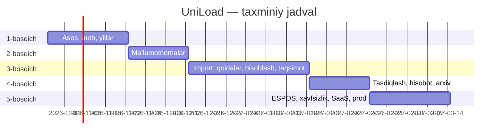

# 10. Bosqichma-bosqich MVP ishlab chiqish rejasi

Muddatlar — 1 nafar full-stack dasturchi uchun taxminiy hisob; har bir bosqich oxirida demo va sizning tasdig‘ingiz.

## 1-bosqich — Asos (≈ 4 hafta) — ✅ bajarildi (2026-10-17)

> Farqlar: yil nusxalash hozircha faqat semestr kalendarini ko‘chiradi (guruhlar, bandlik, me’yorlar — 2-bosqichda); `draft → calculated` o‘tishi hisoblash moduli (3-bosqich) guard’ini ro‘yxatdan o‘tkazguncha qo‘lda; fakultet/kafedra ko‘lamidagi rollar 2-bosqichda; parolni tiklash xati — mock (log).

| # | Vazifa | Natija |
|---|---|---|
| 1.1 | Monorepo, Docker Compose (postgres, redis, minio, api, worker, frontend), CI (lint, test) | `docker compose up` bilan ishlaydi |
| 1.2 | Backend skeleti: config, DB session, xatolar, logging, `TenantContext`, RLS yordamchilari, audit yozuvchisi | |
| 1.3 | Alembic: `universities`, `plans`, `subscriptions`, `users`, `refresh_tokens`, `roles`, `permissions`, `role_permissions`, `user_roles`, `academic_years`, `semesters`, `year_copy_jobs`, `audit_logs`, `files` + RLS siyosatlari | Migratsiyalar oldinga/orqaga ishlaydi |
| 1.4 | Auth: login, refresh rotatsiyasi, logout, `/me`, parolni tiklash (email — konsolga mock) | |
| 1.5 | RBAC: ruxsatlar katalogi, 5 tizim roli, ko‘lam tekshiruvi, `require_permission` dependency | |
| 1.6 | Universitet admin: foydalanuvchilar va rollar CRUD; Super Admin: universitet yaratish (minimal) | |
| 1.7 | O‘quv yillari: CRUD, holat mashinasi, semestrlar, bo‘sh yil yaratish; nusxalash ustasining skeleti (ma’lumotnomalar 2-bosqichda qo‘shiladi) | |
| 1.8 | Frontend: layout, sidebar (15 bo‘lim, keyingilari “tez orada”), YearSwitcher, Light/Dark, i18n, login, dashboard (bo‘sh holatdagi kartalar), o‘quv yillari sahifalari, foydalanuvchilar/rollar sahifalari | |
| 1.9 | Demo seed: 2 ta demo universitet, har bir roldagi demo foydalanuvchilar, 2026–2027 yil | |
| 1.10 | Testlar: unit (holat mashinasi, ruxsatlar), integration (auth, yillar), **tenant isolation** (A ↔ B) | |

**Qabul mezonlari:** demo foydalanuvchilar bilan kirish; UA foydalanuvchi va rol yarata oladi; OB 2027–2028 bo‘sh yilni yaratadi va holatlarni almashtira oladi; A universitet foydalanuvchisi B universitet yilini ko‘ra olmaydi (test); barcha o‘zgarishlar audit logda; Swagger ishlaydi.

## 2-bosqich — Ma’lumotnomalar (≈ 3 hafta)

Fakultetlar, kafedralar, yo‘nalishlar, fanlar katalogi, mashg‘ulot turlari, o‘quv rejalari (versiyalash, `CurriculumGrid`), guruhlar va oqimlar, o‘qituvchilar, yillik bandlik, lavozim me’yorlari. Nusxalash ustasi to‘liq ishlaydi (kursni ko‘tarish, bitiruvchilar, bandlik).

**Qabul:** 2026–2027 demo ma’lumotlaridan 2027–2028 nusxalanadi, manba yil o‘zgarmagani test bilan isbotlangan.

## 3-bosqich — Hisoblash va taqsimot (≈ 6 hafta, PDF’larga bog‘liq)

1. Excel import (o‘quv reja, guruhlar, o‘qituvchilar): moslashtirish → validatsiya → ko‘rish → commit → tarix.
2. **Sizdan:** 2026–2027 PDF yuklamalari va me’yoriy hujjatlar.
3. PDF tahlil: jadvallarni ajratish, normalizatsiya, `rule_candidates`.
4. Rules Engine: DSL, qoida muharriri, sandbox, versiyalar, ikki kalitli faollashtirish.
5. Hisoblash engine’i + trace + golden testlar (PDF natijasi bilan 100% moslik).
6. Taqsimot oynasi (drag-and-drop + jadval), validatsiyalar, tavsiyalar.

**Qabul:** demo kafedra uchun hisoblangan yuklama PDF bilan to‘liq mos; kafedra mudiri taqsimlab, yubora oladi; ortiqcha yuklama va taqsimlanmagan soatlar ko‘rsatiladi.

## 4-bosqich — Tasdiqlash, hisobotlar, arxiv (≈ 3 hafta)

Sozlanadigan tasdiqlash zanjiri, qaytarish/izohlar, override; 9 ta hisobot, Excel (openpyxl) va PDF eksport, universitet shablonlari; arxivlash; audit log UI.

## 5-bosqich — ESPOS, xavfsizlik, SaaS, production (≈ 4 hafta)

ESPOS adapter + mock + outbox (haqiqiy API — hujjatlar kelgach); tenant isolation va pentest sinovlari, rate-limit; tariflar va obuna limitlari; production deployment (reverse proxy, TLS, monitoring, backup va tiklash sinovi).

---

## Tasdiqlash uchun savollar

Birinchi modulni boshlashdan oldin quyidagilar bo‘yicha qaroringiz kerak:

1. **Loyiha joylashuvi.** Hujjatlar hozir `kovsh/uniload/docs/` ichida (bu papka YOLO loyihasining git repozitoriyasi). UniLoad uchun alohida papka/repozitoriya ochamizmi (masalan `Desktop/uniload`)?
2. **Fakultet va kafedralar** tenant darajasida (yilga bog‘lanmagan, tarix `is_active`/`merged_into` orqali) saqlanishi ma’qulmi, yoki har yil uchun alohida tuzilma kerakmi?
3. **Tasdiqlash zanjiri (sukut):** Kafedra mudiri yuboradi → O‘quv bo‘limi → Prorektor (o‘quv ishlari bo‘yicha). To‘g‘rimi?
4. **Auth:** JWT + httpOnly refresh cookie ma’qulmi? Kelajakda OneID / universitet SSO kerak bo‘ladimi?
5. **Joylashtirish:** universitetning o‘z serveri yoki bulut (masalan, mahalliy data-markaz)? Bu shaxsiy ma’lumotlar to‘g‘risidagi qonun talablari uchun muhim.
6. **Celery** fon vazifalari uchun ma’qulmi?
